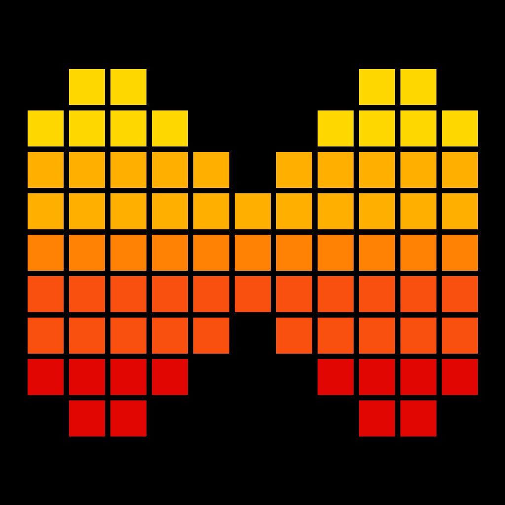

<h1 align="center">localvoxtral</h1>

<p align="center">
  
</p>

<p align="center">
  <strong>Talk to your coding agents. Keep every word on your Mac.</strong><br />
  Realtime, fully local dictation for the menu bar. Press a key and speak. Your words appear while you're still talking.
</p>

<p align="center">
  <a href="#install">Install</a> ·
  <a href="https://t0msilver.github.io/localvoxtral/docs/">Documentation</a> ·
  <a href="https://t0msilver.github.io/localvoxtral/docs/coding-agents/">Coding agents</a> ·
  <a href="CONTRIBUTING.md">Contributing</a>
</p>

<p align="center">
  <a href="https://github.com/T0mSIlver/localvoxtral/stargazers"></a>
  &nbsp;
  <a href="https://github.com/T0mSIlver/localvoxtral/releases/latest"></a>
  &nbsp;
  <a href="LICENSE"></a>
</p>

https://github.com/user-attachments/assets/81a341ff-0c53-4fcf-9b7f-ef148b24dfae

localvoxtral streams text as the audio arrives instead of transcribing after you stop speaking. It runs open streaming speech models on your own Apple Silicon: Mistral AI's [Voxtral Mini 4B Realtime](https://huggingface.co/mistralai/Voxtral-Mini-4B-Realtime-2602) by default, or NVIDIA's [Nemotron 3.5 ASR Streaming](https://huggingface.co/nvidia/nemotron-3.5-asr-streaming-0.6b) or [Nemotron Unified ASR](https://huggingface.co/nvidia/nemotron-labs-unified-asr-0.6b) on Macs with less memory.

It is built first for [prompting coding agents by voice](https://t0msilver.github.io/localvoxtral/docs/coding-agents/), and it works as a general dictation app in any other app too. Everything runs on-device, with no account and no subscription. Nothing leaves your Mac unless you point it at a server yourself.

## Install

```bash
curl -fsSL https://raw.githubusercontent.com/T0mSIlver/localvoxtral/main/scripts/install.sh | bash
```

Or install with Homebrew:

```bash
brew install --cask T0mSIlver/localvoxtral/localvoxtral
```

You can also download the latest DMG from [Releases](https://github.com/T0mSIlver/localvoxtral/releases/latest). localvoxtral needs an Apple Silicon Mac on macOS 15 or later. The local engine downloads about 6 GB on first setup and runs best with 16 GB of memory; on an 8 GB Mac, turn polishing off or pick the smaller models in Settings → Engines.

On first launch, a setup wizard asks for permissions and downloads the engine.

## Features

- **Streams as you speak.** Your words appear while you're still talking, transcribed on your Mac. No telemetry, no account, no cloud fallback ([how it works](https://t0msilver.github.io/localvoxtral/docs/under-the-hood/)).
- **One key.** Tap or hold Fn/Globe to dictate into an overlay you review before it commits, or type live into the focused app ([shortcuts](https://t0msilver.github.io/localvoxtral/docs/dictation/)).
- **Keeps your words.** Optional LLM polishing fixes punctuation and misheard words, and leaves the rest as you said it. Fix a misheard name once before you send a prompt, and the app spells it right in that project from then on ([your terms](https://t0msilver.github.io/localvoxtral/docs/dictation/#teach-it-your-terms)).
- **Built for coding agents.** Dictate into Claude Code, [Codex](https://t0msilver.github.io/localvoxtral/integrations/codex/), [opencode](https://t0msilver.github.io/localvoxtral/integrations/opencode/) and [Mistral Vibe](https://t0msilver.github.io/localvoxtral/integrations/vibe/), in any terminal, a [herdr](https://herdr.dev) or [cmux](https://github.com/manaflow-ai/cmux) pane, over SSH, or a [claude.ai/code](https://claude.ai/code) tab. Dictation joins the Claude Code session under your cursor, and polishing reads its screen and the files it touched. "dash dash force" becomes `--force` ([details](https://t0msilver.github.io/localvoxtral/docs/coding-agents/)).
- **Know when an agent needs you.** When a coding agent waits for an answer, localvoxtral shows a banner, plays a sound and marks the menu bar icon (turn on **Tell me when an agent needs you** in Settings → Dictation) ([details](https://t0msilver.github.io/localvoxtral/docs/agents/)).
- **Hosted models, or your own server.** With one Mistral key, dictation can run on Voxtral Realtime 3 and polishing on Mistral Medium 3.5 instead, and either can point at any OpenAI-compatible endpoint. Only then does anything leave your Mac ([details](https://t0msilver.github.io/localvoxtral/docs/under-the-hood/#mistral-api)).
- **Multilingual.** Dictate in English, French, or any other language your speech model understands. Polishing answers in the language you spoke (English and French are covered by the test suite).

> [!TIP]
> If localvoxtral is useful to you, a ⭐ on this repo helps others find it.

## Documentation

Every guide is listed in the [documentation index](https://t0msilver.github.io/localvoxtral/docs/).

## License

[MIT](LICENSE)
